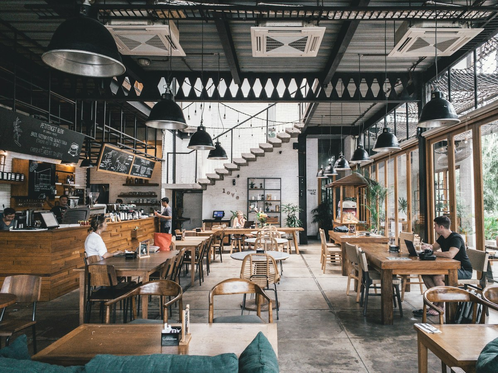

# VRestaurant | Good Food, Great Moments 🍽️🌿

A clean, responsive, and functional restaurant web application built entirely using **HTML5, Vanilla CSS, and JavaScript**.



---

## 🌟 Key Features

- **Interactive Cart System**: Add and remove items, adjust quantities, calculate total bill in real time, and proceed to checkout.
- **Menu Categorization**: Easily filter dishes across *Pizza & Pasta*, *Burgers & Snacks*, *Desserts*, and *Drinks*.
- **Table Booking Reservation**: Interactive table booking form with guest count, date selection, and instant confirmation.
- **Today's Special Deal**: Highlighted signature deals with discounts and one-click order capability.
- **Customer Testimonials & Reviews**: Verified customer feedback with avatars and ratings.
- **Food & Ambiance Gallery**: High quality food imagery.
- **Contact & Inquiry**: Integrated contact form and restaurant location/hours details.
- **100% Vanilla Tech Stack**: Pure HTML, CSS, and JavaScript with zero heavy dependencies or external frameworks.

---

## 🚀 How to Run Locally

You can run this project locally without any installation or build tools:

### Option 1: Open in Browser
Double-click `index.html` or open it with your favorite browser.

### Option 2: Run via Local Server (Python)
```bash
# In the project directory
python3 -m http.server 8080
```
Then navigate to:
```
http://localhost:8080
```

---

## 📂 Project Structure

```
VRestaurant-Website/
├── assets/
│   └── images/              # Food, hero, customer, and gallery imagery
├── index.html               # Main semantic HTML structure
├── style.css                # Responsive stylesheet and layout
├── script.js                # Core JavaScript functionality (cart, filters, booking)
├── .gitignore               # Ignored system files
└── README.md                # Project documentation
```

---

## 👨‍💻 Author

- **GitHub**: [@lakshyabrother](https://github.com/lakshyabrother)
- **Repository**: [VRestaurant-Website](https://github.com/lakshyabrother/VRestaurant-Website)
